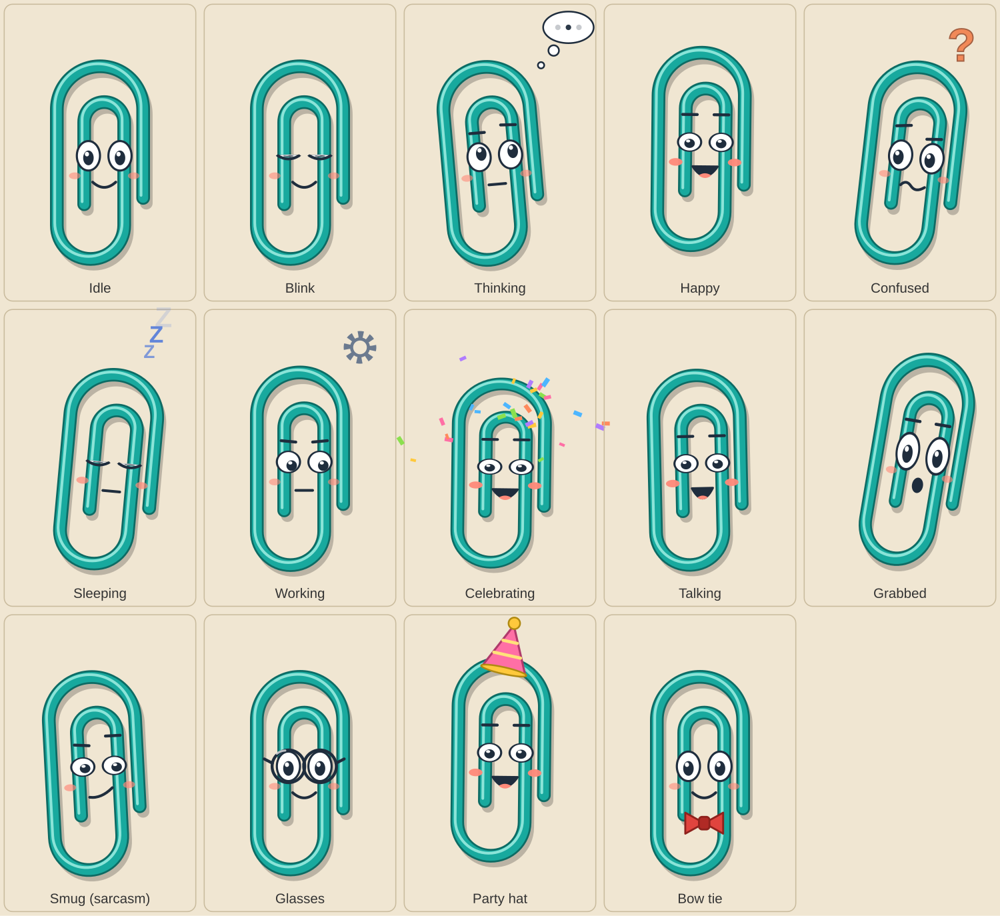

# PaperClippy

A nostalgic, lightweight Windows desktop companion: a little animated paperclip named **Gem** who lives on
your desktop, reacts to you, talks in retro speech bubbles, and (soon) keeps your sticky notes, to-dos, reminders
and focus sessions company.

Native WPF on .NET 10. Fully offline. No account, no telemetry, no cloud. All data stays in a local SQLite file.

> **Status: Milestone 2 of 5 (Mascot experience).** Gem is alive: it blinks, glances around, follows your mouse
> with its eyes, bounces, sleeps, and talks in speech bubbles with a personality that is funny and occasionally
> sarcastic. Clicking Gem opens a little menu. Notes, to-dos, reminders, the focus timer and themes are **not
> built yet** - see [docs/ROADMAP.md](docs/ROADMAP.md).



## Original work

PaperClippy is an independent product. [PaperTodo](https://github.com/snownico0722/PaperTodo) (PolyForm
Noncommercial license) was studied only to understand the desktop-paper experience; no PaperTodo code or
assets are used. Gem is original artwork and is not Microsoft's Office Assistant.

## Build and run (Windows 10/11, x64 or ARM64)

Requires the [.NET 10 SDK](https://dotnet.microsoft.com/download).

```powershell
dotnet build PaperClippy.sln
dotnet test  PaperClippy.sln
dotnet run --project src/PaperClippy.App
```

To experiment without touching your real data (this also gives you the first-run intro every time):

```powershell
$env:PAPERCLIPPY_DATA_DIR = "$env:TEMP\paperclippy-dev"
dotnet run --project src/PaperClippy.App
```

Data lives in `%LOCALAPPDATA%\PaperClippy` (`data\paperclippy.db`, `logs\paperclippy.log`).

## What Gem does

<<<<<<< HEAD
**Animation** - nine states (idle, thinking, happy, confused, sleeping, working, celebrating, talking, grabbed) plus a
sarcastic _smug_ face. At rest Gem blinks (sometimes twice), glances around and takes a breath; its eyes follow the
pointer while it is over Gem; it squashes when clicked, startles when woken, swings like it's dangling when dragged,
and throws confetti when celebrating. "Animation: Off" keeps the faces but removes all motion.

**Speech bubbles** - retro cream cards with a pointer toward Gem, a hard offset shadow, a stitched inner border,
typewriter text (Gem's mouth flaps while it "types"), a dismiss ×, buttons, and timed dismissal that pauses while you
hover. The bubble picks the side of Gem with room (beside first, then above, then below) and stays on Gem's monitor.
=======

- Transparent, borderless, always-on-top mascot window; drag it anywhere. Right-click for _Hide_ / _Exit_.
- Position, visibility and size are saved and restored.
- Never lost off-screen: after a drag, a monitor change or a resolution change, Gem is pulled back to the
  nearest visible monitor. First launch: bottom-right corner of the primary monitor.
- Per-monitor DPI v2; positions are handled in physical pixels, so mixed-DPI multi-monitor setups behave.
- System tray icon: double-click toggles Gem; menu has Show/Hide, _Bring Gem to the Corner_, Exit.
- Single instance: launching again wakes the running copy (and shows Gem if hidden) instead of starting another.
- SQLite storage with versioned migrations (WAL mode). A damaged database file is quarantined (renamed
  `*.corrupt-<time>`, never deleted) and a fresh one is created. A database from a _newer_ build is refused untouched.
- Rolling log file; unhandled UI exceptions are logged instead of killing the companion.
- Idle cost: no timers or animation loops run while idle.

## Verification status

**Personality** - 107 hand-written lines, no AI, no network. Three attitudes: _Gentle_ (warm, never sarcastic),
_Playful_ (the default: funny, about one line in six dry or sarcastic) and _Sassy_ (about 60% sarcastic). Lines never
repeat back-to-back, some are only said at the right time of day, and every sarcastic line comes with a smug face.

**Looks** - sizes from 50% to 200%, and accessories (glasses, party hat, bow tie). Colours are defined in one palette
object so other colours can be offered later.

**Courtesy** - Gem only speaks unprompted every so often (never / rarely / sometimes / often), never within three
minutes of its last remark, never over a menu, never in Quiet mode or your quiet hours. It falls asleep when you've been
away (default 5 minutes) and welcomes you back. While hidden it runs nothing at all.

**Settings dialog** (tray -> _Gem Settings..._ or the menu): show/hide, size, accessory, animation, attitude, chattiness,
bubble duration, quiet mode, quiet hours, sleep delay, eyes following the mouse, and the focus option below.

**Focus** - clicking Gem normally activates its window like any window. _"Don't take keyboard focus" (experimental,
off by default)_ uses a non-activating window so the app you were typing in stays active. It needs testing on real
hardware before it becomes the default - see [docs/TESTING.md](docs/TESTING.md).

Everything from Milestone 1 still applies: draggable, remembers where it lives, never lost off-screen, tray icon,
single instance, SQLite with migrations and damaged-file recovery.

## Verification status

This was written in a Linux sandbox with no access to NuGet or Windows. Here is exactly what was and was not verified:

| Part                                                                                                                                          | State                                                                                                                                                                                                                                  |
| --------------------------------------------------------------------------------------------------------------------------------------------- | -------------------------------------------------------------------------------------------------------------------------------------------------------------------------------------------------------------------------------------- |
| **`PaperClippy.Core`**: animation engine, personality, speech timing/shape/placement, settings, menu, and the "brain" that ties them together | Built with warnings-as-errors. **173 unit tests executed and passing**, including simulated hours of chatter, sleep and menu use on a virtual clock. Tests were mutation-checked (broke the logic on purpose and confirmed they fail). |
| How Gem _looks_                                                                                                                               | Real animator output was rendered to images and reviewed (`assets/mascot/expressions.png`, `bubble-style.png`). The XAML mirrors that structure but has not been rendered by WPF.                                                      |
| SQL and SQLite behaviour the persistence layer relies on                                                                                      | Checked against SQLite 3.45 directly.                                                                                                                                                                                                  |
| `PaperClippy.Infrastructure` + its 14 tests                                                                                                   | Type-checked against an API-shaped stub of `Microsoft.Data.Sqlite`. **Never executed.**                                                                                                                                                |
| `PaperClippy.App` (WPF windows, bubble, settings dialog, tray, Win32 interop)                                                                 | **Never compiled or run.** XAML well-formed; every XAML name, handler and resource key cross-checked against code by script; code desk-reviewed.                                                                                       |

So the first `dotnet build` / `dotnet test` on Windows is the real test of Infrastructure and App - expect, at worst,
small compile fixes. [docs/TESTING.md](docs/TESTING.md) lists the manual checks, riskiest first.

## Layout

```
src/PaperClippy.Core            pure logic, zero dependencies: animation, personality, speech, brain (runs/tests anywhere)
src/PaperClippy.Infrastructure  SQLite, migrations, file log (Microsoft.Data.Sqlite)
src/PaperClippy.App             WPF shell: Gem's window and view, bubble, settings dialog, tray, Win32 interop
tests/                          xUnit tests for Core and Infrastructure
assets/                         Gem artwork (SVG sources, expression sheet), icons
docs/                           architecture, roadmap, mascot identity, manual test plan
```

More: [Architecture](docs/ARCHITECTURE.md) · [Roadmap](docs/ROADMAP.md) · [Gem's identity](docs/MASCOT.md) · [Testing](docs/TESTING.md)
