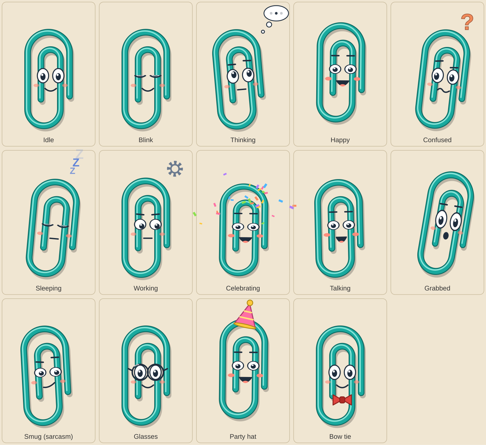

# Gem — visual identity

**Gem** is a vinyl-coated *gem clip* (the double-loop paperclip is literally called a "gem clip"). Original design;
deliberately not silver, not Microsoft's character, and not drawn from its artwork.

| | |
|---|---|
| Body | Teal vinyl coating `#18A99E`, dark edge `#0D6B64`, glossy highlight `#A6F2E6` |
| Face | Large white eyes with a dark outline and a shine dot, coral cheeks, a small smile. **Eyebrows appear only while Gem is expressing something** (thinking, confused, smug, ...), so resting Gem keeps its own look |
| Personality | Cheerful, a little cheeky, supportive — "a friend who is good at reminding you, not a nag" |
| Silhouette | Tall double loop; reads clearly even as a flat shape |
| Source | `assets/mascot/gem.svg` (the XAML in `MascotWindow.xaml` uses the same path data) |
| Small sizes | `assets/icons/gem-icon.svg`: face removed, rotated 38°, bolder wire so it stays legible at 16–32 px (tray, exe icon) |

Design notes for Milestone 2 animation: eyes, pupils and mouth are separate shapes so blinking, looking around and
talking need no new art; the wire is a single path so squash/stretch and head-tilt are transforms. Planned states:
Idle, Thinking, Happy, Confused, Sleeping, Working, Celebrating, Talking.

## Expressions (Milestone 2)

`Idle`, `Thinking` (eyes up, thought cloud), `Happy` (squinting grin, bounce), `Confused` (head tilt, mismatched brows,
wobbly mouth, question mark), `Sleeping` (closed eyes, drifting Zs, drooping head), `Working` (narrowed eyes, focused
brows, spinning dashed ring), `Celebrating` (big bounces, confetti), `Talking` (mouth flaps; can borrow another state's
face), `Grabbed` (wide eyes, "o" mouth, swings with drag speed) and `Smug` (half-lidded, one brow up, smirk), which
Gem wears for sarcastic lines. Blinking, glancing and breathing run underneath every calm state.

## Personality

Gem is a cheerful paperclip with no hands and strong opinions about desktop clutter. Humor rules: Gem's own situation
(no arms, vinyl-coated, bendy) is always fair game; teasing the user stays light and affectionate; nothing mean. Three
levels - Gentle, Playful (default), Sassy - change the *mix* of warm, witty and sarcastic lines, not the character.

## Accessories and colour

Glasses, party hat and bow tie are shapes in `GemView` that tilt and squash with the body. Colours come from
`GemPalette` (default: Teal), so offering other colours later means adding palettes and a setting.
